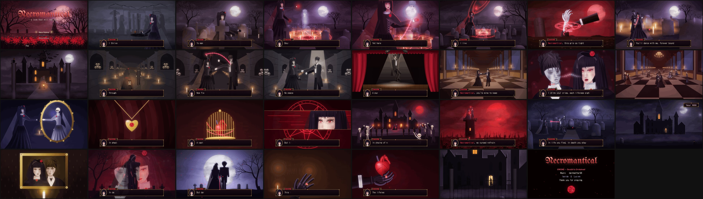

# Necromantical — Music Video

A fully animated gothic romance horror music video for **"Necromantical" by darkmatter96**,
painted in a dark, macabre oil-painting style: full-HD painted scenes with visible brushwork and
canvas grain, chiaroscuro portraits, blood moons and candlelight. A gothic take on the RPG horror
game look (*The Witch's House*, *Ib*, *Mad Father*, *Symbiosis*) runs on top: the lyrics arrive
as the villainess's dialogue in an ornate message window, with choice, status and item windows
and a title menu.

**The story.** Isolde loses her husband Lucien when his carriage plunges from a storm-lashed cliff.
She will not let him rest. At his grave she draws a blood-red circle, binds his rising soul and drags
him back into his corpse. Everything after is told from her side:
- the grip of his hand bursting from the soil and the kiss before the blood moon;
- the waltz among the graves;
- the manor and its crypt;
- his plea for release, and her answer: *"Never. He stays."*;
- his dossier fading to *Undead · Cursed · Puppet*;
- the marionette stage and the ballroom danse macabre;
- the mirror that shows her as a skeleton bride;
- *"Obtained [Lucien's Soul]"*;
- the villagers' torch march, broken when the dead rise;
- her domain bleeding across the map of the valley, and years passing;
- an embrace in chains, and the ending card: *ENDING — Death's Ordained*.



## Output

`build/Necromantical_MusicVideo_1080p.mp4` — 1920×1080, 30 fps, 3:08, H.264 + AAC
(render it yourself with the steps below; `build/` is not committed).

## How it works

Every frame is a pure function of time `t`, drawn on an HTML canvas at 1920×1080:

1. **Scene** (`src/scenes1-4.js`, 68 shots).
   - `env.js`: 2.5D painted environments built on a pinhole camera with depth fog — graveyards,
     the manor, and one-point-perspective hall, crypt and ballroom.
   - `portrait.js`: semi-realistic painted portraits with a turnable head model, chiaroscuro
     shading and bezier hair locks.
   - `rig.js`: full-body figures, dressed skeletons, ghosts, villagers, horses, carriage.
   - `hands.js`: painted hands — living, gloved, corpse and bone.
   - `draw.js`: effects such as chains, sigils, candles, lightning and particles.
2. **Oil-paint pass** (`paint.js`).
   - A summed-area-table Kuwahara filter turns the shapes into brush-like patches.
   - On top go a slowly "boiling" brush-stroke texture, canvas weave and low-frequency colour
     blotches.
   - A soft-light colour grade is set per shot.
3. **Finish** (`post.js`): bloom, flashes, vignette, film grain, screen shake, RGB split and glitch.
4. **UI layer** (`ui.js`), drawn crisp after the paint pass.
   - Ornate gold-framed message window with a painted cameo and typewriter lyrics.
   - Name box, choice card, item banner and title menu.

Lyric timing (`data/timing.json`) was derived from the song itself:
- beat/downbeat tracking and energy envelopes with librosa;
- word-level alignment of the embedded lyrics using a grammar-restricted Vosk recogniser on a
  centre-channel vocal stem, checked against spectrograms.

Each chorus lands on the full-band hit after its dropout.

## Run it

```bash
npm install                                     # Playwright (uses the system Chromium)
open index.html                                 # or serve the folder: live preview player with audio + scrubber
node render/render.mjs --out build/frames --q 0.95   # render all 5662 frames (≈25 min on 4 cores)
bash render/encode.sh                           # mux with audio -> build/Necromantical_MusicVideo_1080p.mp4
node render/render.mjs --stills 36.2,80 --out build/stills   # PNG stills for review
node render/render.mjs --test path/to/shots.js --stills 1 --out build/test   # render a scratch test timeline
node render/check.mjs                           # print the shot timeline, flag gaps/overlaps
```

`index.html?lyrics=0` hides the message window lyrics.

### Re-deriving the lyric timing (`analysis/`)

Scripts take a working directory `$WD` containing `audio/song.wav` (44.1 kHz stereo decode of the MP3)
and write into `$WD/analysis/`:

```bash
python3 analysis/analyze.py  $WD/audio/song.wav $WD/analysis/basic.json   # tempo, beats, loudness
python3 analysis/vocals.py   $WD/audio/song.wav $WD/analysis               # REPET-SIM foreground + spectrograms
python3 analysis/center.py   $WD/audio/song.wav $WD/audio/center16k.wav    # centre-channel vocal stem
python3 analysis/vosk_run.py <vosk-model-small-en-us-0.15> $WD/audio/center16k.wav lyrics.txt $WD/analysis/vosk_center_g.json grammar
python3 analysis/align.py    $WD                                           # lyric words -> per-line estimates
python3 analysis/build_timing.py $WD data/timing.json                      # hand-verified line windows + envelopes
echo "window.TIMING = $(cat data/timing.json);" > data/timing.js              # what index.html loads
```

Fonts: UnifrakturMaguntia, Cinzel, Cinzel Decorative, IM Fell English (+ SC)
(Google Fonts, SIL Open Font License).

The earlier pixel-art (RPG Maker) version of the video is in the git history (commit `ee778b0`).
