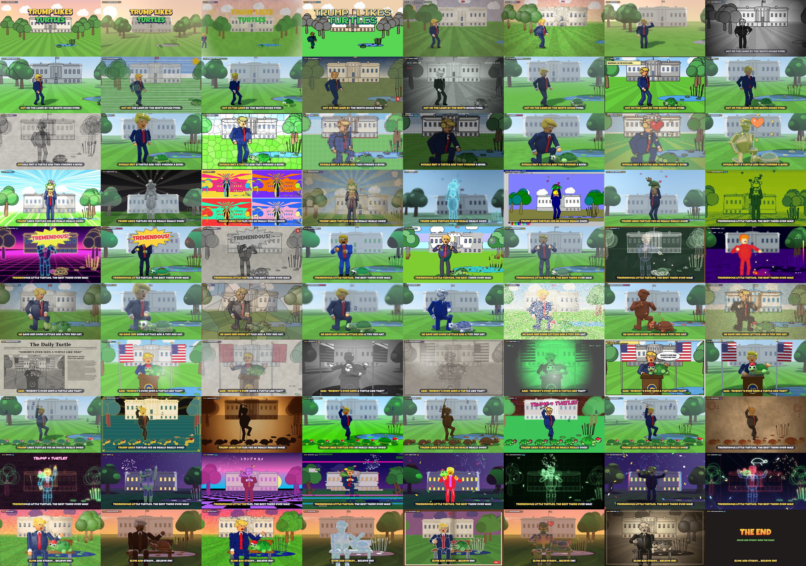

# Trump Likes Turtles

A 40-second animated music video: an original, light-hearted song about Donald Trump
befriending a turtle on the White House lawn. **The animation style changes every half
second — 80 styles in 40 seconds** — while the story, characters, camera and choreography
stay continuous, so it plays as one coherent cartoon that just keeps changing its skin.



- **Watch:** `trump-likes-turtles.mp4` (1280×720, 30 fps, 40.0 s)
- **Play it live in a browser:** open `index.html` (lyrics and style labels can be toggled;
  ←/→ steps one beat / one style, space plays/pauses)

## How the 80 styles stay coherent

The song is 120 BPM in 4/4, so one beat is exactly 0.5 s: **every style change lands on a
beat** (20 bars × 4 beats = 80 beats = 80 styles).

Everything is driven by one score (`audio/score.py`): the lyrics, melody, chords and sound
effects. The story timeline (`js/story.js`) reads the same score, so the turtle pops out of
its shell on the "bloop", camera flashes fire on the shutter clicks, the fireworks burst on
the booms and Trump lip-syncs the choruses.

The characters are 3D puppets built from simple shapes (`js/rig.js`). Each style is just a
different way of rendering the *same* puppet scene at the *same* moment:

- **2D styles** (`js/render2d.js`, `js/styles2d*.js`) project the puppets into flat shapes and
  paint them: ink outlines, watercolor washes, crayon scribbles, halftone dots, stitches,
  mosaic tiles, neon tubes, ASCII characters and so on.
- **3D styles** (`js/render3d.js`) ray-march the very same shapes as signed distance fields in
  WebGL2, with a different material per style (clay with fingerprints, voxels, toy bricks,
  felt, gold, marble, porcelain, ice, chocolate, hologram, thermal camera…).
- **Claymation / stop-motion** styles hold frames at 8–12 fps and nudge the puppets slightly
  between frames, like hand-animated models.

## Lyrics

> *Out on the lawn by the White House pond,*
> *Donald met a turtle and they formed a bond.*
>
> *Trump likes turtles, yes he really, really does!*
> *Tremendous little turtles, the best there ever was!*
>
> *He gave him some lettuce and a tiny red hat,*
> *said, “Nobody’s ever seen a turtle like that!”*
>
> *Trump likes turtles, yes he really, really does!*
> *Tremendous little turtles, the best there ever was!*
>
> *Slow and steady… believe me!*

The vocals are sung by a stock text-to-speech narrator voice that is pitched and timed onto
the melody (auto-tune style). It is deliberately not an imitation of Donald Trump's voice.
The TTS model is driven phoneme by phoneme so every vowel starts on its note, then the WORLD
vocoder snaps the pitch to the melody. As an intelligibility check, Whisper transcribes the
sung vocal track with a 1.4% word error rate (6.8% on the full mix).

## The 80 styles

| # | Time | Style | Kind | What happens |
|---|---|---|---|---|
| 1 | 0.0s | Classic Cartoon | 2D | Title card over the White House at dawn |
| 2 | 0.5s | 3D Animated Feature | 3D |  |
| 3 | 1.0s | Watercolor | ART |  |
| 4 | 1.5s | 8-Bit Pixel Art | RETRO |  |
| 5 | 2.0s | Paper Cut-Out Stop-Motion | STOP-MOTION | Trump strolls onto the South Lawn and waves |
| 6 | 2.5s | Oil Painting | ART |  |
| 7 | 3.0s | Low-Poly 3D | 3D |  |
| 8 | 3.5s | 1930s Rubber Hose | 2D |  |
| 9 | 4.0s | Anime Cel-Shaded 3D | 3D | Walking across the lawn toward the pond |
| 10 | 4.5s | Kid's Crayon Drawing | 2D |  |
| 11 | 5.0s | Toy Brick Stop-Motion | STOP-MOTION |  |
| 12 | 5.5s | Ukiyo-e Woodblock | ART |  |
| 13 | 6.0s | Security Camera | OTHER |  |
| 14 | 6.5s | Felt Puppet Stop-Motion | STOP-MOTION |  |
| 15 | 7.0s | Comic Book | 2D |  |
| 16 | 7.5s | Voxel 3D | 3D |  |
| 17 | 8.0s | Pencil Sketch | ART | Spots a shell, the turtle pops out, he kneels to shake its flipper |
| 18 | 8.5s | Vinyl Toy | 3D |  |
| 19 | 9.0s | Stained Glass | ART |  |
| 20 | 9.5s | Fuse Beads | CRAFT |  |
| 21 | 10.0s | ASCII Art | RETRO |  |
| 22 | 10.5s | Claymation | CLAYMATION |  |
| 23 | 11.0s | Cross-Stitch | CRAFT | A heart appears |
| 24 | 11.5s | Golden Statue | 3D |  |
| 25 | 12.0s | Epic Anime | 2D | Lifts the turtle to the sky |
| 26 | 12.5s | Marble Statue | 3D |  |
| 27 | 13.0s | Pop Art | ART |  |
| 28 | 13.5s | Renaissance Fresco | ART |  |
| 29 | 14.0s | Hologram | 3D | Spins around with it |
| 30 | 14.5s | 90s Paint Program | RETRO |  |
| 31 | 15.0s | Crochet Amigurumi | CRAFT |  |
| 32 | 15.5s | 4-Shade Handheld LCD | RETRO |  |
| 33 | 16.0s | Synthwave Neon | 2D | Sets it down; they dance (TREMENDOUS!) |
| 34 | 16.5s | Modeling Dough | CLAYMATION |  |
| 35 | 17.0s | Ink Wash (Sumi-e) | ART |  |
| 36 | 17.5s | Balloon Animals | 3D |  |
| 37 | 18.0s | Rotoscope | 2D | Double thumbs-up |
| 38 | 18.5s | Origami Papercraft | CRAFT |  |
| 39 | 19.0s | Chalkboard | 2D | Points at the turtle |
| 40 | 19.5s | Thermal Camera | OTHER |  |
| 41 | 20.0s | Picture Book Gouache | 2D | Feeds it lettuce (crunch crunch) |
| 42 | 20.5s | Plush Toy | CRAFT |  |
| 43 | 21.0s | Cubism | ART |  |
| 44 | 21.5s | Plasticine Close-Up | CLAYMATION |  |
| 45 | 22.0s | Blue Porcelain | 3D | Puts a tiny red hat on it |
| 46 | 22.5s | Pointillism | ART |  |
| 47 | 23.0s | Terracotta Clay Relief | CLAYMATION |  |
| 48 | 23.5s | Roman Mosaic | ART |  |
| 49 | 24.0s | Newspaper Halftone | 2D | Press conference on the lawn, cameras flashing |
| 50 | 24.5s | VHS Tape | RETRO |  |
| 51 | 25.0s | Courtroom Sketch | ART |  |
| 52 | 25.5s | Film Noir 3D | 3D |  |
| 53 | 26.0s | Victorian Engraving | ART | Points at the turtle on the podium |
| 54 | 26.5s | Night Vision | OTHER |  |
| 55 | 27.0s | Comic Strip | 2D |  |
| 56 | 27.5s | Action Figure Stop-Motion | STOP-MOTION |  |
| 57 | 28.0s | Tin Toy | 3D | Turtle parade, Trump as drum major |
| 58 | 28.5s | Art Deco Poster | ART |  |
| 59 | 29.0s | Shadow Puppets | 2D |  |
| 60 | 29.5s | Tilt-Shift Miniature | 3D |  |
| 61 | 30.0s | Wood Carving | CRAFT |  |
| 62 | 30.5s | Graffiti | ART |  |
| 63 | 31.0s | 90s Console 3D | RETRO |  |
| 64 | 31.5s | Cave Painting | ART |  |
| 65 | 32.0s | Neon Sign | 2D | Fireworks at night, turtle on his shoulder |
| 66 | 32.5s | Chrome | 3D |  |
| 67 | 33.0s | Vaporwave | RETRO |  |
| 68 | 33.5s | Glitch Art | OTHER |  |
| 69 | 34.0s | Gummy Candy | 3D | Thumbs-up / arms wide |
| 70 | 34.5s | Oscilloscope Vector | RETRO |  |
| 71 | 35.0s | Red/Cyan Anaglyph 3D | 3D |  |
| 72 | 35.5s | Laser Show | OTHER |  |
| 73 | 36.0s | Impressionist | ART | Sunset on a park bench, shell pats |
| 74 | 36.5s | Chocolate Sculpture | 3D |  |
| 75 | 37.0s | Van Gogh Swirls | ART |  |
| 76 | 37.5s | Ice Sculpture | 3D |  |
| 77 | 38.0s | Pop-Up Book | CRAFT | Thumbs-up |
| 78 | 38.5s | Bronze Monument | 3D |  |
| 79 | 39.0s | Silent Film | 2D | Turtle winks; iris out |
| 80 | 39.5s | 1940s Color Cartoon | 2D | THE END |

## Building it yourself

Requirements: Node 18+, Python 3.11+, ffmpeg, and a Chromium for Playwright.

```bash
# 1. the song (downloads a ~60 MB TTS voice into build/cache on first run)
pip install -r audio/requirements.txt
python3 audio/build_song.py          # -> build/song.wav, song.mp3

# 2. the video (renders every frame in headless Chromium, then muxes with ffmpeg)
npm install playwright
node render/render.js                # -> trump-likes-turtles.mp4
node render/render.js --res 360      # quick low-res preview
node render/render.js --beats 20-23  # re-render only some beats, then re-encode

# handy for development
node render/frames.js out.png 12.25        # one still
node render/frames.js sheet.png sheet 0 80 # contact sheet, one frame per beat
```

Frames are cached in `build/` (git-ignored); the 3D styles render in software
WebGL when no GPU is present, which takes roughly 15–30 minutes for the full video.

## Credits

- Fonts: Luckiest Guy and Permanent Marker (Apache 2.0), Press Start 2P (OFL), via Fontsource.
- Singing voice: Piper TTS voice `en_US-joe-medium` (dataset CC0), re-pitched with the WORLD vocoder.
- Everything else — music, sound effects, characters, renderers — is generated by the code in this folder.

This is a good-natured parody / fan cartoon. It is not affiliated with or endorsed by anyone it depicts.
